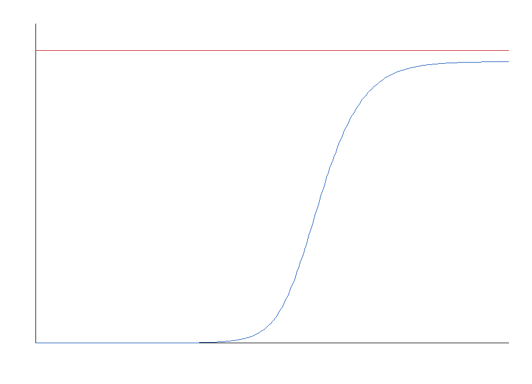
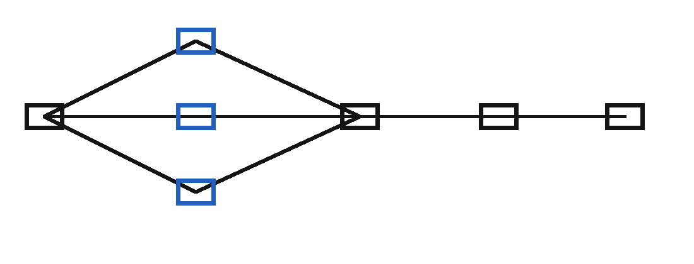
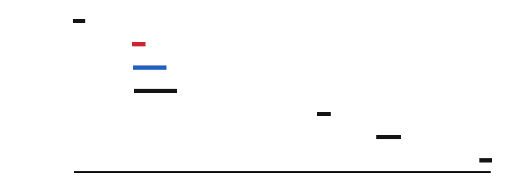

# Debye lattice heat-capacity crossover audit

This deterministic workflow evaluates Peter Debye's universal lattice heat-capacity curve and audits its quantum low-temperature `T³` law and classical Dulong–Petit limit. Three independent activities compute the direct heat-capacity integral, the derivative of an independently integrated internal energy, and the analytic asymptotes.



The figure plots `C_V/R` against reduced temperature `T/Θ_D`; the red horizontal line is the classical limit `3R`. The animation reveals the crossover as the sampled temperature range expands.


## Reproduce

```sh
./build.sh
./preflight.sh
./run.sh
AKOFLOW_SUBMIT=1 ./run.sh
```

The pinned Python 3.11.14 image uses only the standard library. Scientific execution is offline and contains no Hub credentials or host Docker socket. Local execution is a preflight; the recorded AkôFlow daemon run is execution evidence.

## Interpretation and limitations

The result is universal in reduced temperature and does not fit a material-specific Debye temperature or experimental calorimetry. The approximation models acoustic modes with a continuum density and sharp cutoff; it omits optical phonons, electronic heat capacity, defects, and anharmonicity.

## Citation, authorship, and license

Scientific source: Peter Debye, “Zur Theorie der spezifischen Wärmen,” *Annalen der Physik* **344**(14), 789–839 (1912), [DOI 10.1002/andp.19123441404](https://doi.org/10.1002/andp.19123441404). The article is cited but not redistributed.

The original workflow code and generated artifacts are maintained by UFFeScience for AkôFlow Community Explorer and licensed under the MIT License. Python is distributed under the PSF License.

## Measured execution

Daemon run `community-debye-heat-run-v1` completed all seven activities in 7.633 seconds. The direct-integral, energy-derivative, and asymptotic branches overlapped for 0.143 seconds on three distinct declared resources. The matched one-slot run `community-debye-heat-run-one-slot-v1` completed in 10.765 seconds. This is an observed result for this host and image, not a generalized speedup claim.

The two independent numerical formulations agree within `3.553e-15` in `C_V/R`. The last frozen grid point within 1% of the low-temperature cubic law is `T/Θ_D = 0.0865964`; the first within 1% of `3R` is `2.23872`. The image digest and complete artifact checksums are in `evidence/`.





The DAG shows the three independent scientific calculations joining at aggregation; the timeline is rendered from recorded daemon start and finish timestamps.
