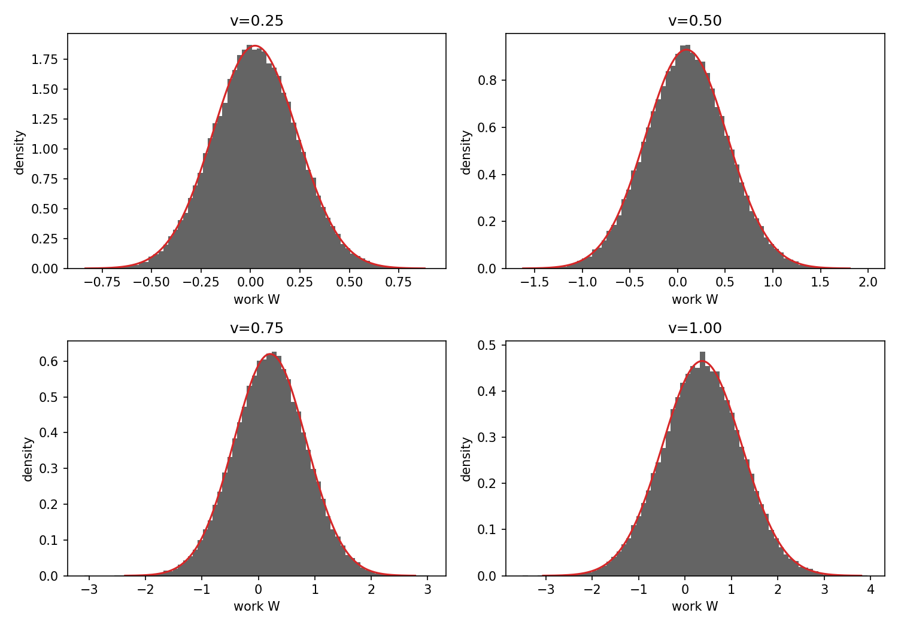
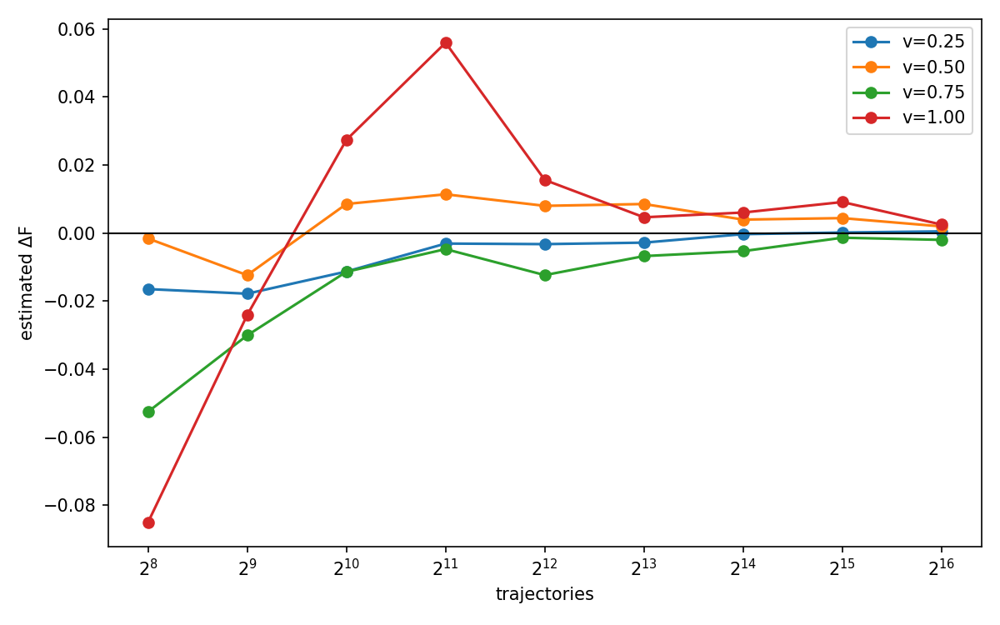
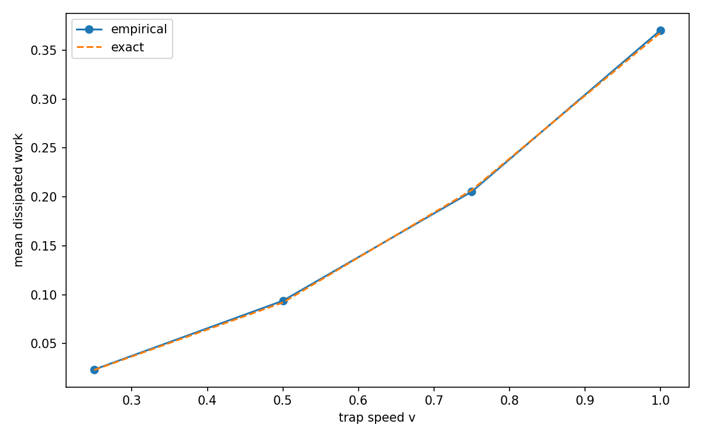
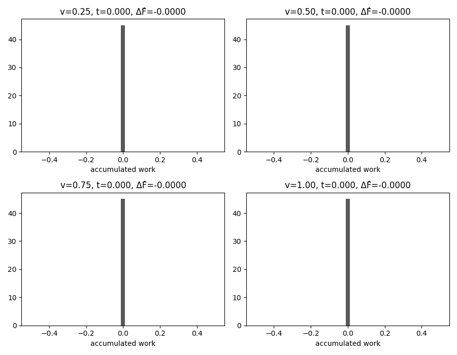
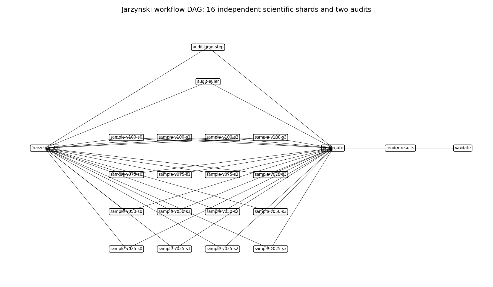
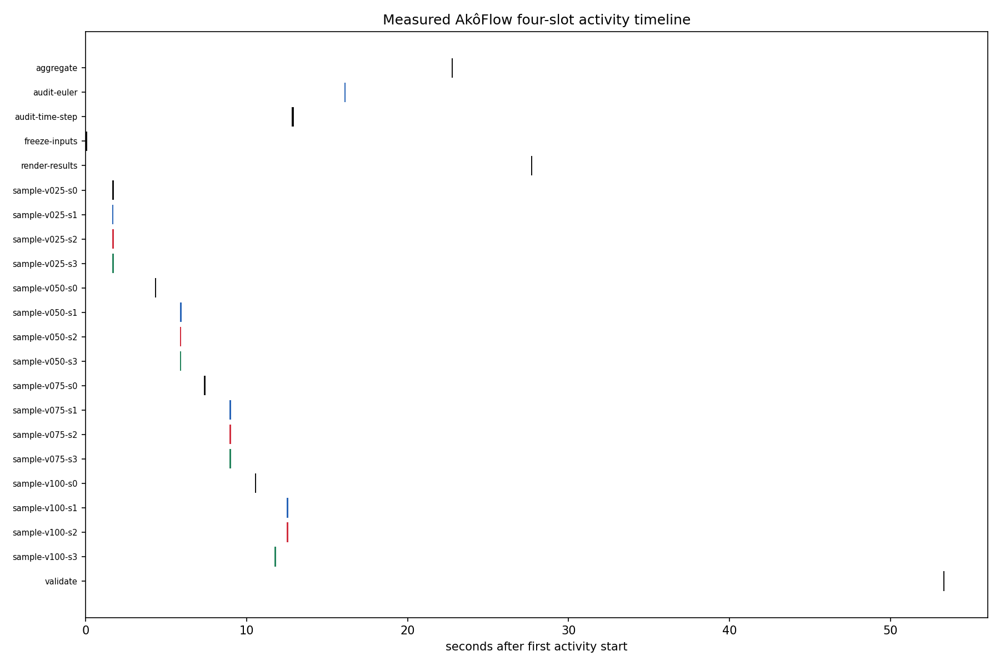

# Jarzynski dragged-harmonic-trap free-energy audit

This deterministic CPU workflow tests the Jarzynski equality for a Brownian particle in a harmonic trap translated at four speeds. Sixteen independent trajectory shards expose scientific concurrency; exact Ornstein–Uhlenbeck state updates and trapezoidal path work produce 65,536 trajectories per speed.



The histograms are measured path-work ensembles; red curves are the exact Gaussian densities.



The finite-sample estimator approaches the translation-invariant target, ΔF=0, as the ensemble grows.



Measured mean work is compared with the exact law μ=v²/e.



The 41-frame animation uses actual accumulated trajectory work from t=0 to 1; it is not interpolated decoration.

## Reproduce

```sh
./build.sh
./preflight.sh
./run.sh
AKOFLOW_SUBMIT=1 ./run.sh
```

The pinned container executes offline without Hub credentials or the host Docker socket. Local execution is a preflight; recorded daemon runs are execution evidence.

## Scientific definition and limits

In dimensionless units k=γ=kBT=β=1, the trap is U=(x-λ)²/2 with λ=vt and τ=1. Work is W=-v∫(x-λ)dt. The continuous process predicts μ=v²(τ-1+exp(-τ)), variance 2μ, and E[exp(-W)]=1. This is a one-dimensional overdamped Markovian model, not a molecular or laboratory free-energy measurement. Translation forces ΔF=0, and the bounded speeds do not establish general rare-event efficiency.

## Citation, authorship, and license

Scientific sources: Christopher Jarzynski, “Nonequilibrium Equality for Free Energy Differences,” *Physical Review Letters* 78, 2690–2693 (1997), [DOI 10.1103/PhysRevLett.78.2690](https://doi.org/10.1103/PhysRevLett.78.2690); and R. van Zon and E. G. D. Cohen, “Stationary and transient work-fluctuation theorems for a dragged Brownian particle,” *Physical Review E* 67, 046102 (2003), [DOI 10.1103/PhysRevE.67.046102](https://doi.org/10.1103/PhysRevE.67.046102).

Original workflow code and generated artifacts are maintained by UFFeScience and MIT-licensed. Third-party notices are included.

## Measured execution

AkôFlow daemon run `community-jarzynski-run-v1` completed all 22 activities in
53.346 seconds on four declared slots. The matched one-slot run
`community-jarzynski-run-one-slot-v1` completed in 77.479 seconds, an observed
host-specific makespan ratio of 1.452; this is not a generalized speedup claim.
The measured timestamps show simultaneous independent shards—for example, all
four `v=0.25` shards overlapped from 02:54:06.987 to 02:54:07.085 UTC.

The final mean works were `0.0233880`, `0.0937810`, `0.205303`, and `0.370483`;
the corresponding estimated free energies were `0.000517`, `0.001976`,
`-0.001981`, and `0.002518`. Every prospective completeness, moment, scaling,
bootstrap, Jarzynski, refinement, Euler, determinism, and media gate passed.
The daemon `work-summary.csv` SHA-256 exactly matches the committed reference
artifact. The executed image is
`sha256:618acd24dcfd65b0e6d6867277119f4db61b13e34437d91b7c26f360139d94a0`.



The DAG records the 16 independent stochastic-trajectory branches, two
independent numerical audits, and their fixed aggregation path.



The timeline is rendered directly from daemon activity start and finish
timestamps; colors identify the four declared resources.

## Public Community Explorer version

[Open the public workflow, recorded run, gallery, and downloads](https://hub.akoflow.com/o/akoflow/community-explorer-issue-51-jarzynski-dragged-trap-v1).
Import immutable version 1 with
`akoflow://hub/publications/7178176c-e846-4692-97a4-461a38e01b02/versions/1`.
