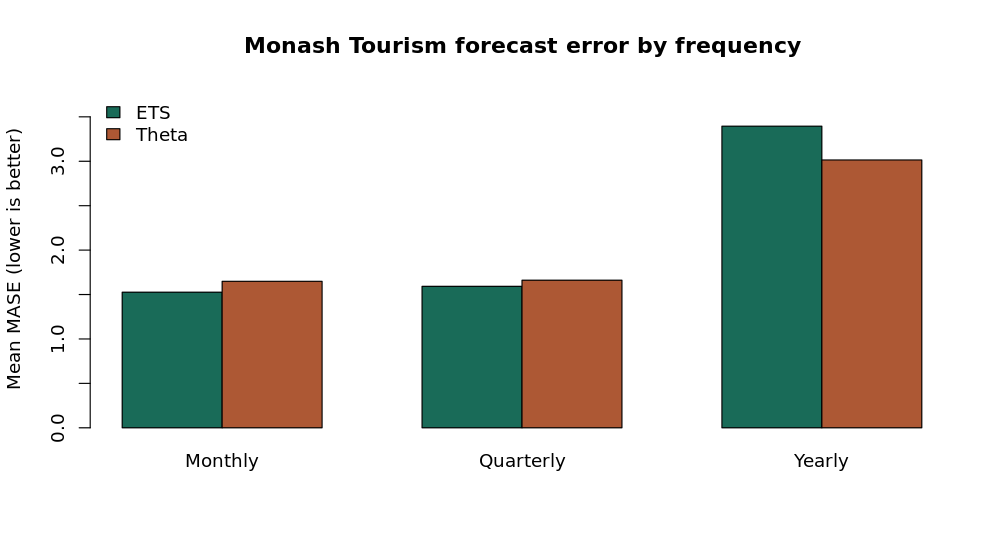
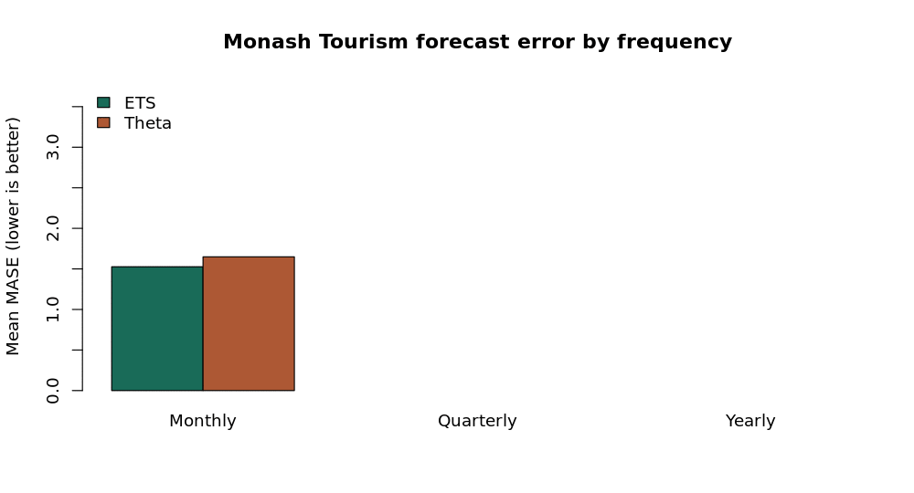
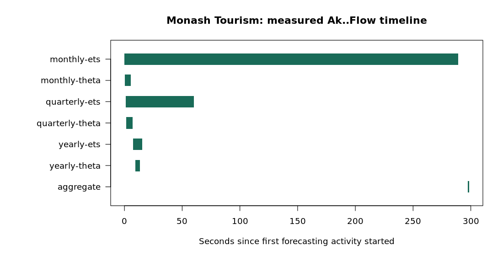

# Monash Tourism ETS and Theta benchmark

This workflow checks the six published mean absolute scaled error (MASE)
scores for local ETS and Theta forecasts on the Monash tourism datasets.
It fits each series independently and compares the model ranking across
monthly, quarterly, and yearly observations.

## Paper and data

Rakshitha Godahewa, Christoph Bergmeir, Geoffrey I. Webb, Rob J. Hyndman, and
Pablo Montero-Manso, *Monash Time Series Forecasting Archive*, NeurIPS 2021
Datasets and Benchmarks. The source tourism competition is credited to George
Athanasopoulos, Rob J. Hyndman, Haiyan Song, and Doris C. Wu.
[Archive paper](https://datasets-benchmarks-proceedings.neurips.cc/paper_files/paper/2021/hash/eddea82ad2755b24c4e168c5fc2ebd40-Abstract-round2.html)
[Tourism competition](https://doi.org/10.1016/j.ijforecast.2010.04.009)

The three ZIP archives are from the Monash archive on Zenodo and are
distributed under CC BY 4.0. The model and scoring implementation follows the
pinned authors' reference, also licensed CC BY 4.0. AkôFlow integration is
by the Community Explorer.
[Monthly](https://zenodo.org/records/4656096)
[Quarterly](https://zenodo.org/records/4656093)
[Yearly](https://zenodo.org/records/4656103)
[Pinned reference](https://github.com/rakshitha123/TSForecasting/tree/d187b057af25a203f8b321ad52edf11bc3c8b619)

## Scenario and validation

| Frequency | Series | History used for model fit | Holdout | ETS reference | Theta reference |
| --- | ---: | --- | ---: | ---: | ---: |
| Monthly | 366 | Prefix before holdout | 24 | 1.526 | 1.649 |
| Quarterly | 427 | Prefix before holdout | 8 | 1.592 | 1.661 |
| Yearly | 518 | Prefix before holdout | 4 | 3.395 | 3.015 |

The six frequency/model combinations are independent activities on four
CPU slots. Each writes keyed forecasts, actuals, and series-wise scores.
The final activity checks complete coverage and compares the average of finite
series scores with the published values at an absolute tolerance of 0.005.
MASE uses the training-only seasonal naïve scale. The reference lag-1 fallback
applies when the seasonal score is undefined. The forecasts use R 4.2.2 and
forecast 8.20, with a seasonal naïve fallback on model errors.

## Run

The portable workflow embeds the pinned Debian base recipe, scripts, and
checksum-verified archives. Build locally with
`docker build -f docker/Dockerfile -t community-monash-tourism:v1 .`.
Run `./run.sh` to preflight, then use `AKOFLOW_SUBMIT=1 ./run.sh` to execute.

Outputs include the benchmark comparison CSV, PNG, animation, branch forecast
and error CSVs, and validation report.

## Recorded execution and gallery

The seven activities in run `community-monash-run-v2` completed and the
validator passed. All six scores agreed with the published benchmark within
0.005 MASE. ETS scored lower at monthly and quarterly frequencies, and Theta
scored lower at yearly frequency. All 1,311 series were scored for each model.
The monthly and quarterly ETS activities overlapped for 58.914 seconds.

[Benchmark CSV](outputs/tourism-mase.csv) ·
[Validator result](evidence/validation.json) ·
[Observed execution and output digests](evidence/daemon-run.json)
