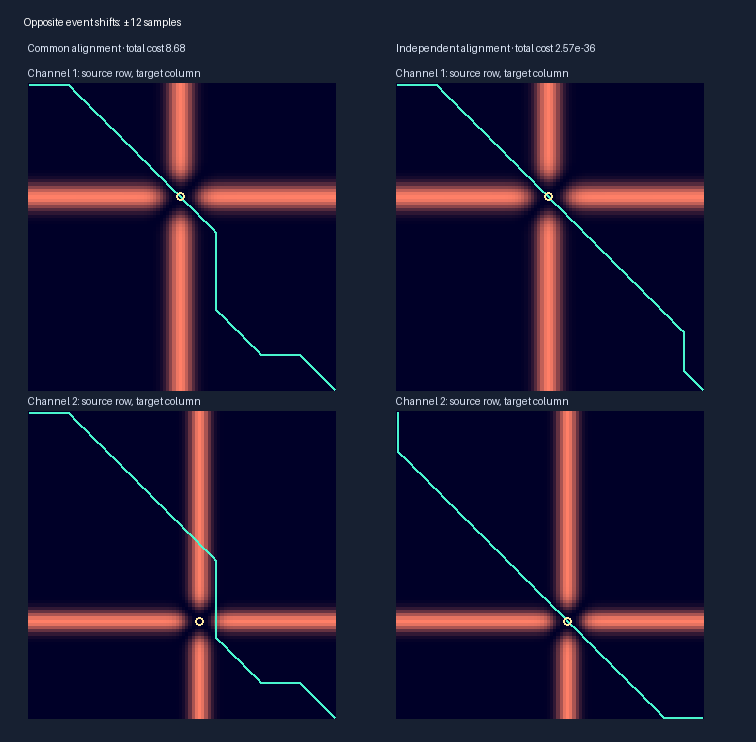
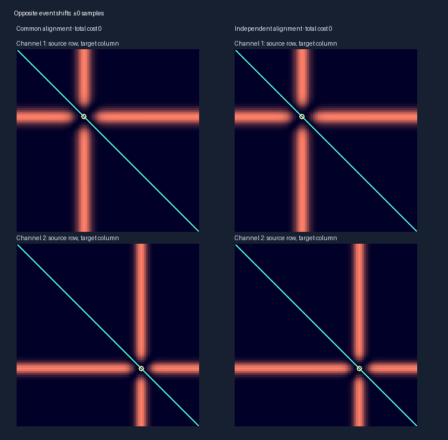
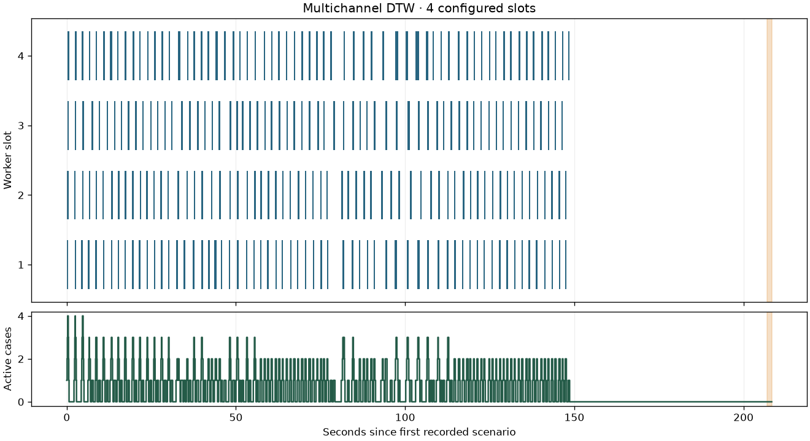

# Common and independent dynamic time warping

This synthetic benchmark isolates temporal alignment choices, inspired by
the [SBBD study by Torres and colleagues](https://sol.sbc.org.br/index.php/sbbd/article/download/30740/30543/).
Two Gaussian event channels share one path in the common strategy. The
independent strategy allows one path per channel, using the same squared
error, endpoints, and allowed steps.

The 256-case design crosses 16 seeds, eight lag levels and both strategies.
Controls cover identical sequences and equal shifts of both channels.

## Measured AkôFlow reference

The four-slot reference completed 257 activities. The reducer validated
256 cases comparing common and independent alignment and checked costs
and event positions against each paired synthetic input.







[Alignment summary](evidence/reference/alignment-summary.csv) ·
[Reference evidence](evidence/reference/reference-run.json).

## Run in AkôFlow

Register the portable recipe and generate the workflow.

```sh
recipe=$(./register-recipe.sh)
python3 generate.py "$recipe"
./run.sh
```

Set `AKOFLOW_API_URL` and `AKOFLOW_API_TOKEN` for the target daemon.
Use `python3 profile.py /path/to/captures` to run or resume the four
scheduling plans and check all 259 scientific output checksums. The timing
report retains worker intervals, observed overlapping tasks and reducer
preparation time. Use `render-timeline.py` to draw a measured capture.

A 192-sample workflow was generated with `--length 192` and passed the
same 257 cold preflight checks as the 96-sample reference.

The original workflow code is released under the [MIT license](LICENSE).
The figures and data are generated from synthetic inputs. The cited paper
is the scientific reference and retains its own terms.
