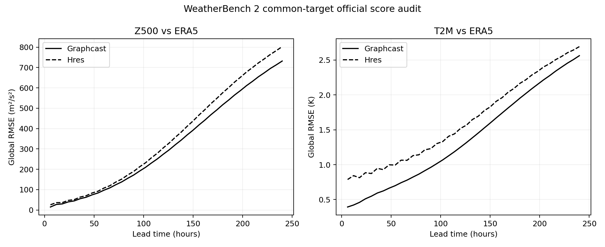
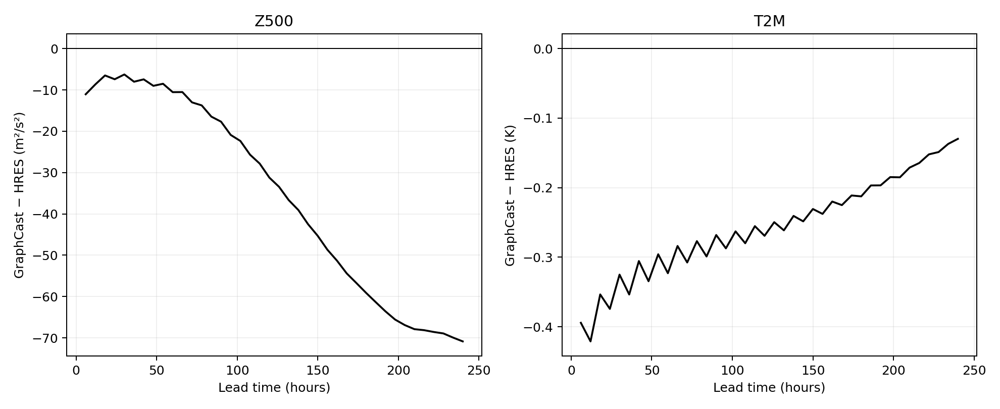
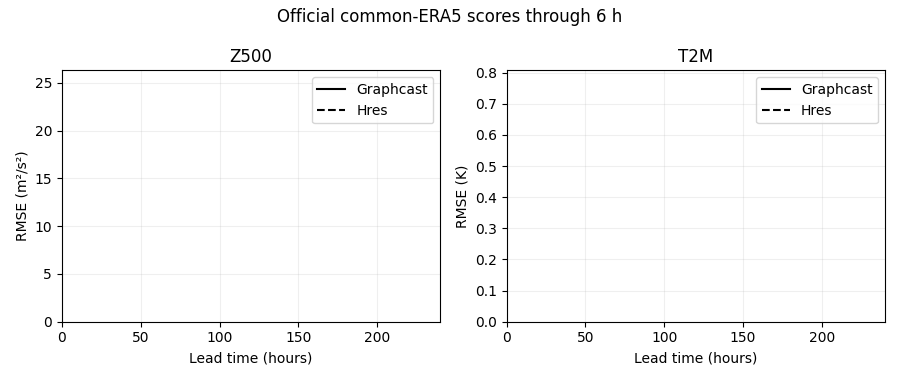
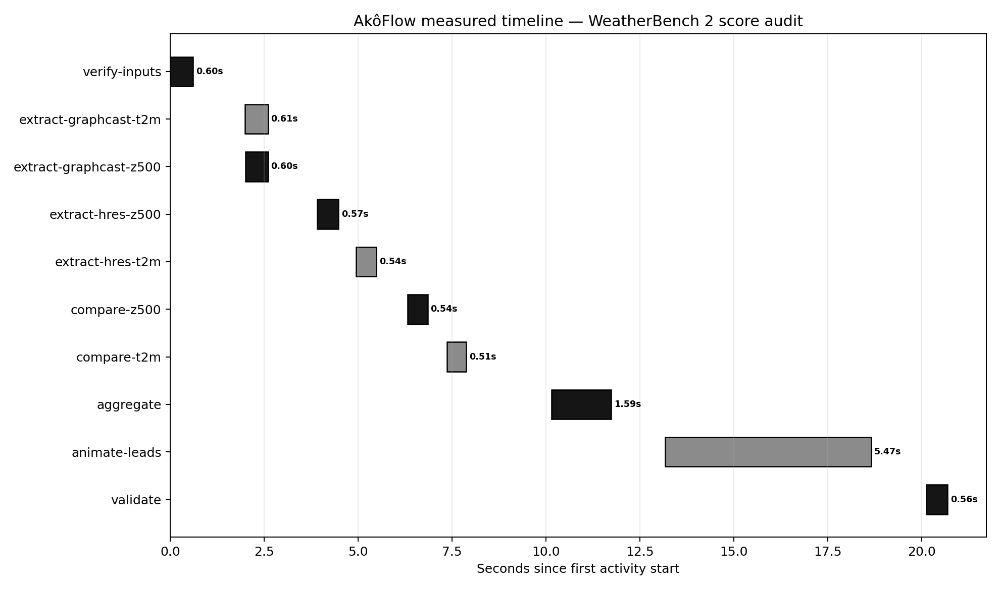

# WeatherBench 2 common-ERA5 score audit

This CPU workflow audits two immutable official WeatherBench 2 score objects for 2020 on the 1.5° grid. It compares GraphCast and IFS HRES global RMSE for Z500 and T2M at the 40 common 6-hour leads from 6 through 240 hours, with ERA5 as the target for both.

This is a method adaptation and official aggregate-score audit. It is not a reproduction of Figure 4 in Rasp et al. (2024): that paper ordinarily compares HRES with the HRES analysis. The workflow does not recompute latitude-weighted RMSE from raw fields, inspect initialization-level completeness, or create spatial error maps.

Run `./build.sh` to perform the separately declared network input-preparation step and build the pinned image. Then run `./preflight.sh outputs/preflight` twice and compare `validation.json`. `./run.sh` imports the workflow into a running AkôFlow daemon; set `AKOFLOW_SUBMIT=1` only after the returned execution preflight is ready.

The scientific image runs offline without credentials or the host Docker socket. Four independent extraction and integrity branches feed two comparison branches, deterministic figures, a lead-time animation, and strict validation against registered float64 hashes.

The authoritative AkôFlow execution is `community-weatherbench2-score-audit-run-v1`, workflow version `community-weatherbench2-score-audit-v1`, plan `community-weatherbench2-score-audit-plan-v1`, and image digest `sha256:1189e4bf1f8abcc6b5cb6fbfe4db954fc5dca6543e34487c2b4a9e24f3ba459c`. It completed 10/10 activities in 20.684039 seconds. The independent GraphCast Z500 and T2M branches overlapped for 0.597863 seconds. This is concurrency evidence only; no speedup is claimed. Validation passed with canonical scientific-result hash `f41b786d485398860ce21861b3ffdb137100bdd68a5957ae92b0a8248a442cea`.

Reference: Rasp et al., “WeatherBench 2: A Benchmark for the Next Generation of Data-Driven Global Weather Models,” JAMES 16 (2024), e2023MS004019, https://doi.org/10.1029/2023MS004019. GraphCast forecasts are credited to Lam et al. (2023). The input-preparation step preserves the exact Google/ECMWF/Copernicus license texts; derived artifacts must retain their attribution and disclaimers.

## Measured result gallery

